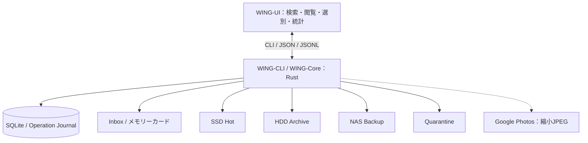
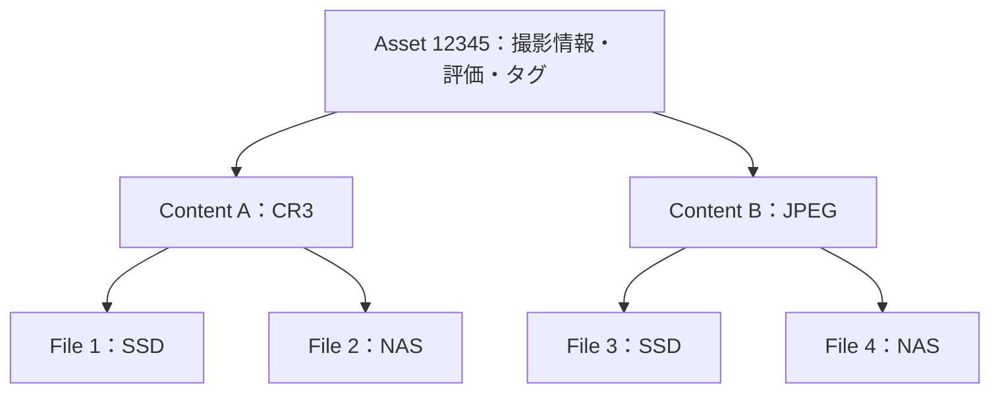
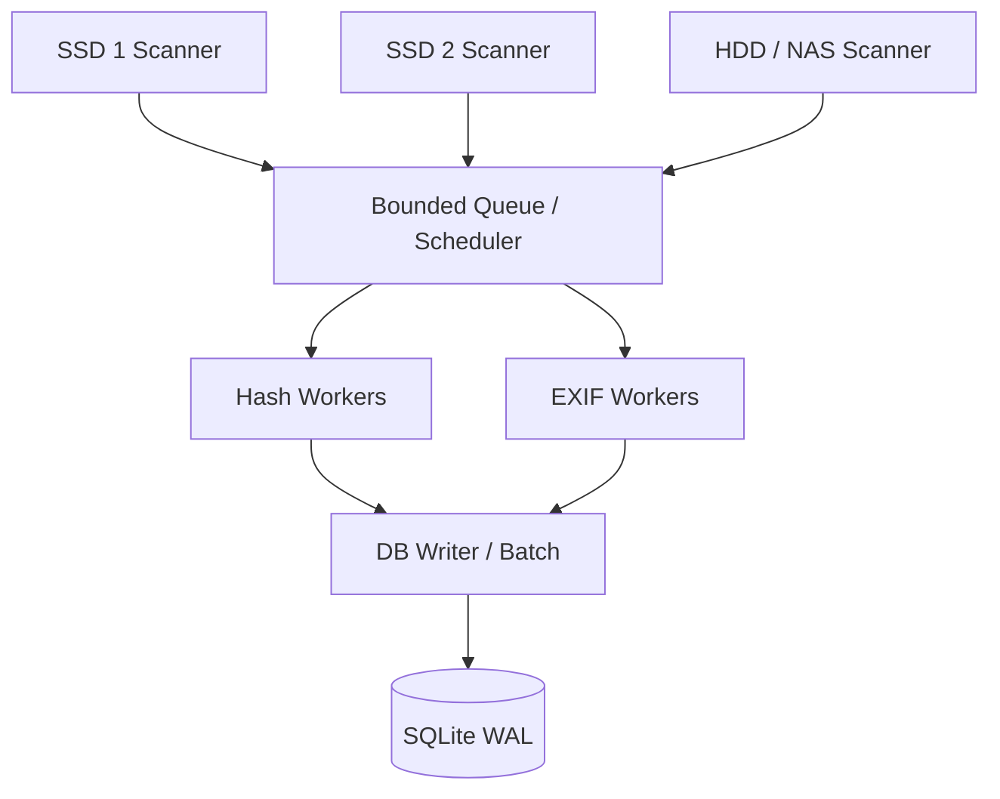
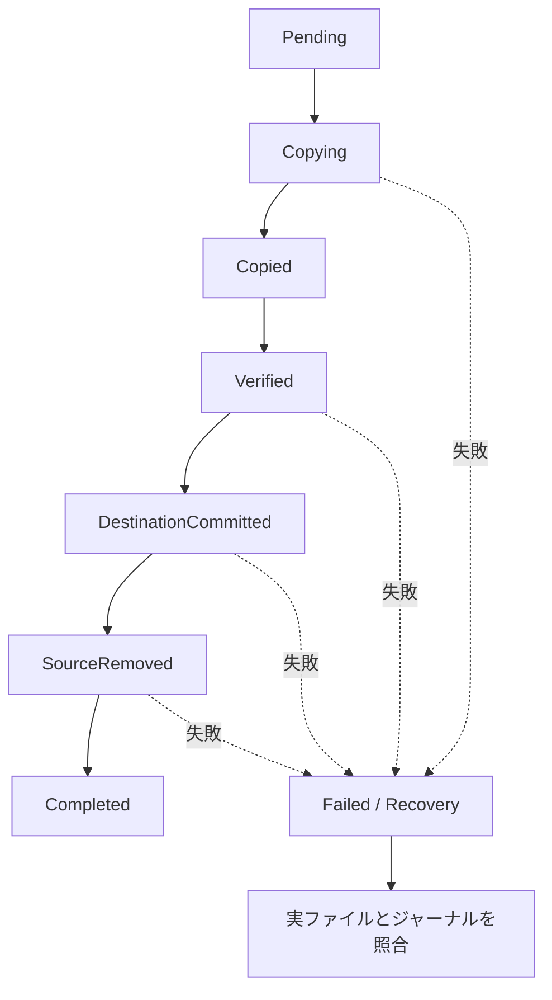
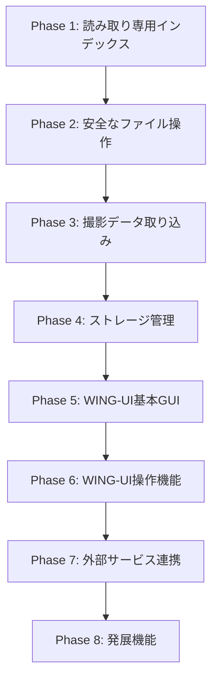

# WING PhotoVault プロジェクト仕様書

- Version: 0.1.0-draft
- Date: 2026-11-24
- Status: 基本構想・要求仕様（設計提案を含む）

## 1. 目的
大量の写真・動画の取り込み、選別、保存、重複排除、階層管理、バックアップ、検索、閲覧までのライフサイクルを効率化する。航空機・野鳥撮影など、1回に数千〜数万枚を撮影する用途を想定する。RAW現像・画像編集ソフトの代替は目的としない。

### 命名コンセプト・構成名称
WINGは略語ではなく、写真資産を自由に探索するための翼という概念。PhotoVaultは写真資産を守る保管庫。既存の「PhotoVault」名称ソフトウェアとの衝突を避けるため、全体を **WING PhotoVault** と称する。

> WING is not an acronym. It is a concept.
>
> PhotoVault keeps your memories safe. WING gives them wings.

| 対象 | 正式名称 | 略称 / 識別名 |
|---|---|---|
| ソフトウェア全体 | WING PhotoVault | — |
| GUIフロントエンド | WING PhotoVault UI | WING-UI |
| CLI | WING PhotoVault CLI | WING-CLI（コマンド名: `wingpv`） |
| コア / バックエンド | WING PhotoVault Core | WING-Core |

## 2. アーキテクチャ



WING-UIはGUIフロントエンド、WING-CLI / WING-Coreは独立して動作可能なバックエンド兼CLIとする。Windowsタスクスケジューラ等による定期実行に対応する。管理上の変更は原則WING-CLI / WING-Coreを経由する。

| 機能 | WING-UI | WING-CLI / WING-Core |
|---|---|---|
| スキャン・取り込み | 操作・進捗表示 | 実処理 |
| EXIF | 表示 | 抽出・DB管理 |
| 検索・統計 | 条件入力・可視化 | 検索・集計 |
| 閲覧 | プレビュー | ファイル情報提供 |
| 連写・評価 | 閲覧・選別 | グループ・評価管理 |
| 重複排除 | 確認・操作 | 判定・隔離 |
| 階層管理・NAS | 状態表示・操作 | 実処理 |
| Googleフォト | 対象選択 | 変換・送信 |
| 障害復旧 | 状態表示・操作 | リカバリー |

## 3. 設計原則
- Safety: オリジナルを失わないことを最優先とする。
- Performance: CPU、ストレージ、ネットワークの性能を活用する。
- Recoverability: 電源断、異常終了、通信切断から安全に復旧する。
- Transparency: 対象、予定、進捗、結果、エラーを可視化する。
- Portability: Windows優先、OS依存部分を分離しLinux/FreeBSD対応を妨げない。
- Maintainability: 過度な抽象化を避け、性能上の複雑化は測定に基づく。

## 4. 技術要件
WING-CLI / WING-Core: Windows 11 x64、Rust Stable、Cargo、ネイティブCLI（`wingpv`）、SQLite WAL、TOML、JSON/JSONL、構造化ログ。同期I/Oとワーカースレッドを基本とし、unsafeは原則使用しない。

WING-UI: Windows 11 x64、Python 3.12+ / PySide6 / uvを候補とする（未確定）。初期連携はCLI。

想定規模: 数TB〜数十TB、数十万〜数百万ファイル、1回1万枚以上、複数NVMe SSD/HDD/NAS、10GbE、JPEG/RAW/動画混在。

## 5. WING-Core / WING-CLI 機能仕様
### 5.1 スキャン
複数ドライブを横断し、パス、名前、サイズ、作成・更新日時、形式、ハッシュ、EXIF、階層、存在状態を登録する。初回・差分・完全検証に対応し、未変更ファイルの再解析を省略する。アクセス不能なストレージを削除済みとみなさない。スキャンは写真ファイルを変更しない。

### 5.2 取り込み
カード、カメラ、任意ディレクトリからSSD Hotへコピーする。標準配置は `YYYY/YYYY_MM_DD/`。日付はEXIF、mtime、実行日、明示指定から選択。サイズ・ハッシュ検証後DB登録。元ファイルはデフォルトで保持し、異内容の同名ファイルを上書きしない。

### 5.3 重複検出・隔離
サイズ→必要に応じ部分ハッシュ→全体ハッシュ→必要に応じバイト比較。SHA-256/BLAKE3は実測で選定しアルゴリズム識別子も保存する。検出と隔離を分離し、保持ポリシーまたは明示指定に従う。意図的なNASバックアップは除外。直接削除せず隔離し、元パス、理由、日時、保持ファイルを記録して復元可能にする。

### 5.4 RAW＋JPEG
同一撮影のRAW/JPEGを名前、撮影日時、カメラ情報等で関連付ける。曖昧な場合は自動確定しない。移動、選別、隔離、バックアップで整合性を維持する。RAWとJPEGは重複ではない。

### 5.5 連写
撮影日時、間隔、カメラ、利用可能な連写識別情報からグループ化する。基準は設定可能とし、推定結果を利用者が修正できるようにする。

### 5.6 階層管理
| 階層 | 用途 |
|---|---|
| Inbox | 未整理・未取り込み |
| Hot | SSD上の直近データ |
| Archive | HDD上の長期保存 |
| Backup | NASバックアップ |
| Quarantine | 重複・不要ファイルの隔離 |

撮影日時等とSSD容量上限を基準にHotからArchiveへ移動する。Hot固定に対応し、Asset IDは維持する。

### 5.7 NASバックアップ
SMB/UNC/マップ済みドライブへの増分コピー。未バックアップ、処理中、完了、検証済み、更新あり、エラー、アクセス不能を管理する。階層移動でNASコピーを不要に再作成しない。デフォルトでは削除を伝播させない。robocopy利用はファイル単位の結果・検証管理が可能なことを条件とする。

### 5.8 EXIF
撮影日時・サブ秒、カメラメーカー・機種・識別情報、レンズ、焦点距離・35mm換算、F値、シャッター速度、ISO、露出補正、画像サイズ、GPS、形式、動画解像度・fps・時間等を取得。表記ゆらぎを正規化する。Rustネイティブ解析とExifToolを候補とし、CR3/MakerNote対応を重点検証する。

### 5.9 検索・統計
撮影期間、機材、焦点距離、F値、シャッター速度、ISO、形式、階層、バックアップ状態、評価、タグ、連写グループで検索する。JSON/CSV出力、指定先へのコピー・移動に対応する。

統計: 年月日別・カメラ別・レンズ別撮影枚数、焦点距離・ISO・シャッター速度分布、容量、重複容量、バックアップ進捗。論理写真単位と物理ファイル単位を選択可能にする。

### 5.10 評価
未選別、採用、不採用、お気に入り、レーティング、タグを管理する。不採用は即削除せず明示操作で隔離する。評価は物理パスに依存しない。

### 5.11 Googleフォト
スマホ検索・閲覧用の選別済み縮小JPEGを送信する。オリジナル保存は目的外。長辺・品質・バッチ上限を設定し、元データを変更しない。送信履歴、重複防止、再試行に対応する。API/OAuth/権限/制限は実装前に確認する。外部連携は独立モジュールとする。

## 6. WING-UI 機能仕様
- 写真ブラウザー: サムネイル、拡大、全画面、ソート、EXIF、RAW/JPEG統合、保存・バックアップ状態、外部現像ソフト連携。JPEG優先、RAW内蔵プレビューを検討。遅延読み込み、仮想スクロール、キャッシュ。
- 検索: 複合条件、条件保存、結果再利用。
- 連写選別: 代表画像、グループ内一覧、グループ・個別採否、RAW/JPEG一括操作、キーボード操作、取り消し。将来は類似画像、ピント・ブレ評価。自動評価のみで削除しない。
- 取り込み: 元・先・日付・対象・重複確認、進捗、結果。
- ストレージ: 使用容量、ファイル数、移動予定、バックアップ、隔離、エラー、復旧待ち。
- 統計: 機材利用傾向、焦点距離、撮影条件等のグラフ表示。

## 7. データモデル
物理ファイル、内容、論理資産を分離する。



論理写真1枚、コンテンツ2種類、物理ファイル4個。

| エンティティ | 主な項目 |
|---|---|
| Assets | Asset ID、撮影日時、メタデータ、連写ID、評価、タグ |
| Contents | Content ID、ハッシュ方式、ハッシュ、サイズ |
| Files | File ID、Asset ID、Content ID、種別、Storage ID、相対パス、更新日時、存在状態、役割 |
| Storages | Storage ID、種別、ルート、階層、識別情報、アクセス状態 |

その他: メタデータ、連写、タグ、バックアップ・隔離・送信・スキャン履歴、操作ジャーナル。移動後もAsset IDを維持する。詳細スキーマとインデックスは別途定義。

## 8. CLI
`wingpv [global-options] <command> [options]`

グローバルオプション: `--config <path>`、`--dry-run`、`--format <text|json|jsonl>`、`--verbose`、`--quiet`、`--help`、`--version`。

| コマンド | 機能 |
|---|---|
| init | 初期化 |
| scan | スキャン・DB更新 |
| import | 取り込み |
| duplicates | 重複検出 |
| quarantine | 隔離 |
| restore | 復元 |
| tier | 階層移動 |
| backup-nas | NASバックアップ |
| verify | 整合性検証 |
| find | 検索・抽出（copy-to/move-to） |
| stats | 統計 |
| groups | 連写管理 |
| rate | 評価更新 |
| upload-gphotos | Googleフォト送信 |
| status | 状態確認 |
| recover | 復旧 |
| benchmark | 性能測定 |

変更系操作のdry-runは対象、予定、移動先、容量を出力し、写真資産・永続管理状態を変更しない。

## 9. インターフェース
CLIから検索・統計・進捗・結果・エラーを構造化出力し、安定した終了コードを提供する。JSONLによる逐次取得、stdoutとstderrの分離、インターフェースのバージョン管理を行う。WING-UIはSQLiteを直接更新しない。将来はPyO3、ライブラリ直接利用、IPCを検討する。

## 10. 設定例
```toml
[general]
db_path = "./wing-photovault.db"
log_dir = "./logs"
image_exts = [".jpg", ".jpeg", ".cr3", ".cr2", ".dng", ".arw", ".nef"]
video_exts = [".mp4", ".mov", ".m4v"]
[paths]
scan_roots = ['D:\Photos\Inbox', 'E:\CameraImport']
ssd_hot_dir = 'D:\PhotoVault\Hot_SSD'
hdd_archive_dir = 'H:\PhotoVault\Archive_HDD'
quarantine_dir = 'D:\PhotoVault\_Quarantine'
nas_backup_dir = '\\nas\photo_backup'
gphotos_temp_dir = 'D:\PhotoVault\_GPhotosQueue'
[import]
directory_template = "%Y/%Y_%m_%d"
date_source = "exif"
delete_source = false
verify_after_copy = true
[scan]
incremental = true
follow_symlinks = false
follow_reparse_points = false
[hash]
algorithm = "sha256"
partial_hash_enabled = true
byte_compare_before_quarantine = true
[performance]
auto_tune = true
ssd_io_workers = 4
hdd_io_workers = 1
nas_io_workers = 2
cpu_workers = 0
queue_capacity = 1024
db_batch_size = 1000
[tiering]
archive_after_days = 90
ssd_max_gb = 0
date_source = "exif"
fallback_date_source = "mtime"
[nas_sync]
use_robocopy = true
robocopy_threads = 8
propagate_deletions = false
verify_after_copy = true
[exif]
backend = "auto"
exiftool_path = ""
persistent_exiftool = true
[exif.lens_aliases]
# "Canon RF200-800mm F6.3-9 IS USM" = "RF200-800mm F6.3-9 IS USM"
[burst]
enabled = true
max_interval_ms = 500
[quarantine]
auto_purge = false
[gphotos]
client_secret_path = "./client_secret.json"
token_cache_path = "./gphotos_token.json"
max_long_edge_px = 2048
jpeg_quality = 85
max_upload_mb = 70
batch_limit = 500
```

## 11. 性能設計

物理デバイス単位で並列度を制御する。同一ディスクの複数パーティションを別デバイスと扱わない。NVMeは積極的に並列化、HDDはシーク抑制、NASは通信性能に応じ調整する。有界キュー、ストリーミングハッシュ、SIMD、差分スキャン、段階的重複判定、読み込み共有を検討する。ExifToolは常駐またはバッチ利用。SQLiteは単一書き込み担当、バッチトランザクション、prepared statement、インデックス、ページキャッシュ、逐次取得を活用する。耐障害性を犠牲にする設定は評価なしに採用しない。

測定指標: files/sec、hash MB/sec、EXIF files/sec、DB records/sec、初回・差分スキャン時間、検索応答、コピー速度、ピークメモリ。性能目標は実測で決定する。

### 参考：5TBの理論読み込み時間
| 持続速度 | 時間 |
|---|---|
| HDD 150 MB/s | 9時間16分 |
| SATA SSD 550 MB/s | 2時間32分 |
| NAS 1000 MB/s | 1時間23分 |
| NVMe 3000 MB/s | 28分 |
| NVMe 7000 MB/s | 12分 |

10進単位の理論値。実際はファイルオープン、シーク、ハッシュ、DB等の負荷が加わる。

## 12. 安全性・復旧
異なるファイルシステム間の移動手順:
1. 操作予定をジャーナルに永続化。
2. コピー先の一時ファイルに書き込み。
3. flush。
4. サイズ・ハッシュ検証。
5. 正式パス確定。
6. 検証済み状態を永続化。
7. 移動元の再確認（変更されていたら削除しない）。
8. 移動元削除。
9. DB更新。
10. 完了記録。

同一ファイルシステム内は安全なrenameを検討する。


ファイルシステムとDBの完全な原子性は前提としない。復旧時に実状態を照合する。異内容上書き、バックアップ隔離、自動purge、対象外変更を禁止。reparse point、長大パス、大文字小文字、ストレージ取り違え、多重起動、DBバックアップ、認証情報のログ漏洩に対処する。

## 13. ソース構成案
```text
wing_photovault/
├── Cargo.toml
├── crates/
│   ├── wing-photovault-core/
│   ├── wing-photovault-db/
│   └── wing-photovault-cli/
├── config.example.toml
├── tests/
├── benches/
├── docs/
└── README.md
```
モジュール: scanner, importer, hashing, metadata, duplicate, burst, storage, tiering, backup, quarantine, journal, recovery, search, statistics, integrations, platform。

| 用途 | 候補 |
|---|---|
| CLI | clap |
| 設定・出力 | serde / toml / serde_json |
| 走査 | walkdir / jwalk |
| 並列 | rayon / crossbeam-channel |
| ハッシュ | sha2 / blake3 |
| SQLite | rusqlite |
| EXIF | kamadak-exif / ExifTool |
| 画像 | image / fast_image_resize |
| HTTP | reqwest |
| 進捗 | indicatif |
| ログ | tracing |
| エラー | thiserror / anyhow |

採用前に対応形式、性能、保守状況、ライセンスを確認する。

## 14. テスト・品質保証
ユニット、統合、CLI、DBマイグレーション、ベンチマーク、回帰テスト。実写真の前にダミーデータで、同名異内容、異名同内容、RAW/JPEG、権限エラー、容量不足、更新競合、NAS切断、DB失敗、強制終了、再実行、隔離復元を検証する。

不変条件:
- コピー先検証前に移動元を削除しない。
- 異内容を無条件に上書きしない。
- 物理移動でAsset IDを変えない。
- 意図的なバックアップを通常の重複排除対象にしない。
- 再実行で意図しないデータ消失を発生させない。
- dry-runで永続管理状態や写真資産を変更しない。

プロパティベーステスト、状態遷移モデル、フォールトインジェクションを検討する。

## 15. 開発ロードマップ

| Phase | 内容 |
|---|---|
| 1 | 設定、CLI、DB、走査、ハッシュ、EXIF、差分、検索・統計、ベンチマーク。写真変更なし |
| 2 | ジャーナル、コピー・移動・検証、復旧、重複、隔離・復元、dry-run |
| 3 | カード取り込み、日付別配置、RAW/JPEG、連写、評価 |
| 4 | SSD/HDD階層、NAS増分・検証、定期実行 |
| 5 | ブラウザー、サムネイル、EXIF検索、統合表示、統計 |
| 6 | 取り込みGUI、連写選別、評価・タグ、重複確認、管理画面、進捗 |
| 7 | Googleフォト、縮小JPEG、OAuth、送信状態 |
| 8 | 類似画像、ピント・ブレ、AI支援、Linux/FreeBSD、API・バインディング |

インターフェース確定後はWING-UIの並行開発も可能。

## 16. 初期対象外
RAW現像、レタッチ、動画編集、AI完全自動削除、クラウド上のオリジナル管理、複数ユーザー同時編集、Web化、スマホ専用アプリ。

## 17. 未決定事項
WING-UI言語・GUI、SHA-256/BLAKE3、CR3解析方式、RAW/JPEG判定、連写判定、保持優先順位、NASディレクトリ・検証方式、robocopyと独自コピーの使い分け、詳細DBスキーマ、最終API、Google Photos API適合性、性能目標。

## 付録 A. 設計変更の理由
### A.1 原点と役割分担
撮影直後の大量写真の整理、保存場所・バックアップ管理、過去の写真資産の検索・活用という3課題を扱う。WING-Core / WING-CLIは管理基盤、WING-UIは人間が写真を操作する層とする。
### A.2 論理資産と物理ファイルの分離
RAW/JPEG/NAS複製を別々の撮影枚数として数えず、階層移動でも評価、タグ、連写、送信履歴を維持する。第7節の図を参照。
### A.3 スキャンと隔離の分離
```sh
wingpv scan
wingpv duplicates
wingpv quarantine --dry-run
wingpv quarantine
```
スキャンを写真に対して非破壊とし、定期実行とテストを容易にする。
### A.4 意図的な複製の保護
同じハッシュでも、意図しない重複とバックアップは異なる。ストレージ・ファイルの役割に基づき後者を保護する。
### A.5 Rust採用理由
高速なネイティブ実行、メモリ効率、並列処理、型による安全性を重視する。ただしI/O設計が性能を左右し、Rustだけでデータ消失を防げるわけではない。同期I/Oと単純なワーカーモデルから始める。
### A.6 GUIとCLIの独立
Phase 1からCLI単体で検索・統計が利用できる。GUI完成を待たずに実用化し、管理処理の定期実行も可能にする。

## 付録 B. 文書の位置付け
本書は会話中の仕様書と後続の設計コメントを統合・整理したドラフトであり、逐語的な会話記録ではない。データモデル、CLI、設定値、開発順序は設計提案。ライブラリのCR3対応、Google Photos APIの現行制約、性能値は未検証である。
