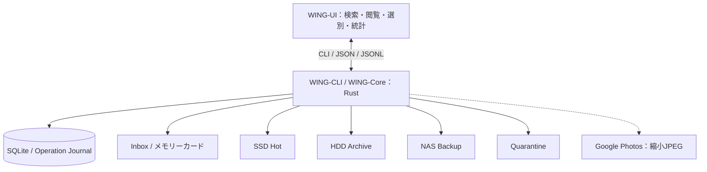
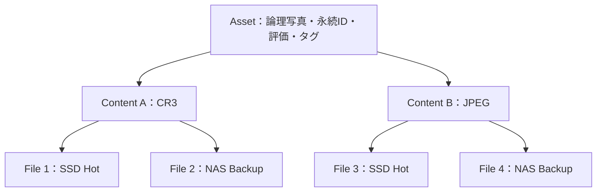
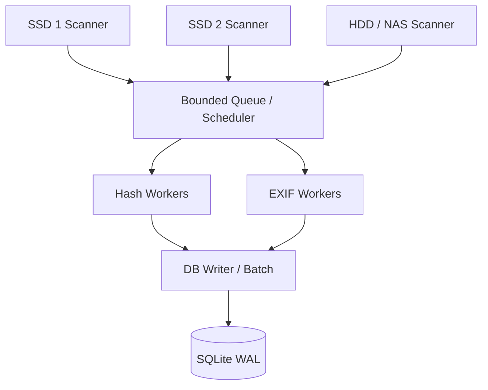
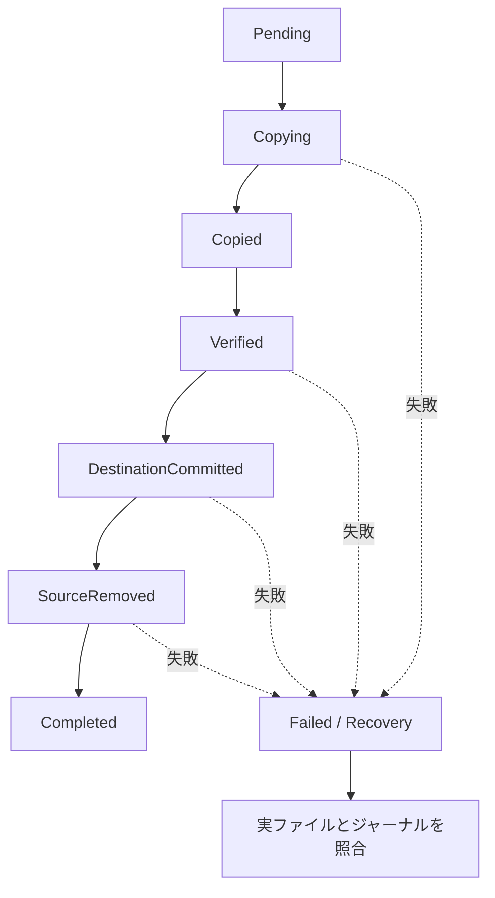
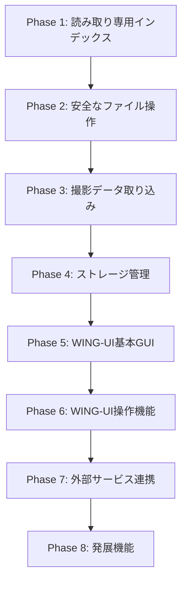

# WING PhotoVault プロジェクト仕様書

- Version: 0.2.0-draft
- Date: 2026-11-25
- Status: 基本構想・要求仕様（設計提案を含む）

## 1. 目的・開発思想
大量の写真・動画の取り込み、選別、保存、重複排除、階層管理、バックアップ、検索、閲覧までのライフサイクルを効率化する。航空機・野鳥撮影など、1回に数千〜数万枚を撮影する用途を想定する。RAW現像・画像編集は Photoshop や Lightroom Classic 等に委ね、WING PhotoVault は写真資産の管理・検索・選別・保護に集中する。

- 個人開発の無料 OSS として開発・公開する（企業向け品質保証やサポートを期待させる表現は用いない）。
- 内部は堅牢かつ高速に保ちつつ、GUI は写真を主役とした軽快な操作感を目指し、利用者に内部の複雑さを意識させない。
- 「将来の拡張を妨げない設計」と「将来機能の先行実装」を明確に区別する。

### 命名コンセプト・構成名称
WINGは略語ではなく、写真資産を自由に探索するための翼という概念。PhotoVaultは写真資産を守る保管庫。既存の「PhotoVault」名称ソフトウェアとの衝突を避けるため、全体を **WING PhotoVault** と称する。

> WING is not an acronym. It is a concept.
>
> PhotoVault keeps your memories safe. WING gives them wings.

| 対象 | 正式名称 | 略称 / 識別名 |
|---|---|---|
| ソフトウェア全体 | WING PhotoVault | — |
| GUIフロントエンド | WING PhotoVault UI | WING-UI |
| CLI | WING PhotoVault CLI | WING-CLI（コマンド名: `wingpv`） |
| コア / バックエンド | WING PhotoVault Core | WING-Core |

## 2. アーキテクチャ



WING-UIはGUIフロントエンド、WING-CLI / WING-Coreは独立して動作可能なバックエンド兼CLIとする。Windowsタスクスケジューラ等による定期実行に対応する。管理上の変更は原則WING-CLI / WING-Coreを経由する。

| 機能 | WING-UI | WING-CLI / WING-Core |
|---|---|---|
| スキャン・取り込み | 操作・進捗表示 | 実処理 |
| EXIF | 表示 | 抽出・DB管理 |
| 検索・統計 | 条件入力・可視化 | 検索・集計 |
| 閲覧 | プレビュー | ファイル情報提供 |
| 連写・評価 | 閲覧・選別 | グループ・評価管理 |
| 重複排除 | 確認・操作 | 判定・隔離 |
| 階層管理・NAS | 状態表示・操作 | 実処理 |
| Googleフォト | 対象選択 | 変換・送信 |
| 障害復旧 | 状態表示・操作 | リカバリー |

## 3. 設計原則
- Safety: オリジナルを失わないことを最優先とする。
- Performance: CPU、ストレージ、ネットワークの性能を活用する。
- Recoverability: 電源断、異常終了、通信切断から安全に復旧する。
- Transparency: 対象、予定、進捗、結果、エラーを可視化する。
- Portability: Windows優先、OS依存部分を分離しLinux/FreeBSD対応を妨げない。
- Maintainability: 過度な抽象化を避け、性能上の複雑化は測定に基づく。

## 4. 技術要件
WING-CLI / WING-Core: Windows 11 x64（主対象）、Rust Stable、Cargo、ネイティブCLI（`wingpv`）、SQLite WAL、TOML、JSON/JSONL、構造化ログ。同期I/Oとワーカースレッドを基本とし、unsafeは原則使用しない。

NAS ローカルスキャン / リモートエージェント想定環境:
- **FreeBSD 15.x**（`eagle`: メインバックアップNAS。Rustネイティブビルドによりローカルスキャン・将来の常駐エージェントに対応）
- **Linux（旧カーネル / `armv7l`）**（`Saturn`: ASUSTOR NAS, Linux 3.10 / armv7l。32bit環境を意識しファイルサイズ等は `u64` で扱い、`musl` 静的ビルドによるローカルスキャンまたは Windows からの SMB 経由スキャンをフォールバックとする）

WING-UI: Windows 11 x64 を先行対象とし、macOS 対応を視野に入れる。フレームワークは Qt/QML、Python 3.12+ / PySide6、Tauri、egui、Slint 等を候補とし、画像表示性能・仮想スクロール・移植性・保守性を評価して選定する（未確定）。初期連携は CLI。

マルチホスト・カタログ共有方針:
- 検索用 SQLite WAL DB とサムネイルは各ホストのローカル SSD 上に配置し、**SQLite DB を NAS 上に置いて複数ホストから直接開く方式は採用しない**。
- 複数ホスト間での所在把握を見据え、Host ID / Storage ID / 外部交換用の永続 ID と、ホストごとのマウントパスを分離して設計する。初期連携はカタログのエクスポート / インポートを候補とする。

想定規模: 数TB〜数十TB、数十万〜数百万ファイル、1回1万枚以上、複数NVMe SSD/HDD/NAS、10GbE、JPEG/RAW/動画混在。

## 5. WING-Core / WING-CLI 機能仕様
### 5.1 スキャン
複数のストレージ（複数NVMe SSD、HDD、NAS等）を横断し、パス、名前、サイズ、作成・更新日時、形式、ハッシュ、EXIF、階層、存在状態を登録する。既存のフォルダ構造（`YYYY/YYYY_MM_DD/`、`100EOSR5` 等のカメラサブフォルダ、NAS上の旧形式 `YYYY/MM_DD/` や `JPEG/`・`RAW/` 分割など）は原則そのまま維持し、まずはどのストレージにどのファイルがあるかを非破壊でマッピングする。レタッチ済み観賞用ワークフォルダ等は初期は除外設定で対象外とし、将来的にファイル名やEXIFからオリジナルAssetと関連付け（derivativeマッピング）できる拡張余地を残す。初回・差分・完全検証に対応し、未変更ファイルの再解析を省略する。アクセス不能なストレージを削除済みとみなさない。スキャンは写真ファイルを変更しない。

### 5.2 取り込み
カード、カメラ、任意ディレクトリからSSD Hotへコピーする。標準配置は `YYYY/YYYY_MM_DD/` とし、カメラサブフォルダ（`100EOSR5` 等）によるファイル名衝突回避も考慮する。日付はEXIF、mtime、実行日、明示指定から選択。サイズ・ハッシュ検証後DB登録。元ファイルはデフォルトで保持し、異内容の同名ファイルを上書きしない。

### 5.3 重複検出・隔離
サイズ→必要に応じ部分ハッシュ→全体ハッシュ→必要に応じバイト比較。SHA-256/BLAKE3は実測で選定しアルゴリズム識別子も保存する。検出と隔離を分離し、保持ポリシーまたは明示指定に従う。意図的なNASバックアップは除外。直接削除せず隔離し、元パス、理由、日時、保持ファイルを記録して復元可能にする。

### 5.4 RAW＋JPEG
同一撮影のRAW/JPEGを名前、撮影日時、カメラ情報等で関連付ける。曖昧な場合は自動確定しない。移動、選別、隔離、バックアップで整合性を維持する。RAWとJPEGは重複ではない。

### 5.5 連写
撮影日時、間隔、カメラ、利用可能な連写識別情報からグループ化する。基準は設定可能とし、推定結果を利用者が修正できるようにする。

### 5.6 階層管理
| 階層 | 用途 |
|---|---|
| Inbox | 未整理・未取り込み |
| Hot | SSD上の直近データ |
| Archive | HDD上の長期保存 |
| Backup | NASバックアップ |
| Quarantine | 重複・不要ファイルの隔離 |

撮影日時等とSSD容量上限を基準にHotからArchiveへ移動する。Hot固定（ファイル・フォルダ単位のPin）に対応し、Asset IDは維持する。同一階層に複数のストレージ（例: 複数台のNVMe SSD）を登録可能とする。

ストレージの属性は以下の独立した軸で管理する:
- **役割（tier）**: `inbox` / `hot` / `archive` / `backup` / `quarantine`
- **アクセス権限（access_mode）**: `managed`（WINGが書き込み可） / `read_only`（参照・検証・復元元のみ。Coreで変更操作を拒否し重複削除候補から除外）
- **接続・健全状態（status）**: `online` / `offline` / `failed` / `retired`（ファイルの存在状態 `present` / `missing` / `corrupted` とは別軸で管理し、未接続を消失とみなさない）
- **障害ドメイン（failure_domain）**: 同一物理ディスクや同一NAS筐体上の複数コピーを独立した冗長性とみなさない（RAIDとバックアップも区別する）

オフラインストレージと故障復元:
- オリジナルがオフラインでも、ローカルSSD上のカタログ・EXIF・評価・永続縮小サムネイルから検索・閲覧できるようにする。
- マスターがオフラインでも、オンラインの正常な複製（Content一致）を参照できる。バックアップから編集する場合は作業領域にコピーする。
- 存在確認日時（`last_seen_at`）と内容検証日時（`last_verified_at`）を分離し、未接続コピーの健全性は未確認として扱う。
- 媒体故障時は、影響ファイル、復元可能な複製、接続が必要な媒体、既知の複製なしを一覧化し、Asset ID・評価・タグを維持したまま復元計画を生成できるようにする。

### 5.7 NASバックアップ・外部バックアップ・リモートスキャン
バックアップは **Managed Backup**（WING自身が実行）と **External Backup**（NAS側Pull型や外部ツールが実行）を区別する。
- **External Backup** は存在確認・必要に応じたハッシュ検証・所在管理・復元元としての読み取りのみを許可し、WINGからは一切更新・削除しない。
- **ランサムウェア対策**: アプリ内の Read Only 設定のみに依存せず、NAS側が独立して Pull 型バックアップを実行し、Windows側には SMB 読み取り専用共有を公開する構成（＋ZFSスナップショット等の世代管理）を前提にできる設計とする。
- SMB/UNC（例: `\\eagle\...`）およびマップ済みドライブの両方に対応。ドライブ文字の変更に影響されにくいよう、設定上の固定ストレージIDとホスト別マウントパスで管理する。
- バックアップ済み判定は相対パス一致ではなく Content（ハッシュ）一致を基本とし、過去データのフォルダ構造差（`YYYY/MM_DD` や `JPEG/`・`RAW/` 分割等）があっても二重バックアップを防ぐ。
- 毎回全件ハッシュ検証を行わず、存在確認と整合性検証（`verify`）を別タスクとする。階層移動でNASコピーを不要に再作成せず、デフォルトでは削除を伝播させない。robocopy利用はファイル単位の結果・検証管理が可能なことを条件とする。

NAS上の大量ファイルのスキャン・ハッシュ検証は、SMB越しの全量転送を避けるため NAS ホスト側でのローカル実行を想定する:
- **Step 1（JSONL連携）**: NAS 上で `wingpv` をローカル実行してスキャン結果（パス・サイズ・更新日時・ハッシュ・EXIF）を標準 JSONL 形式で出力し、Windows 側 DB へ取り込む（SSH 経由パイプ取り込みを含む）。
- **Step 2（常駐エージェント）**: 必要に応じて FreeBSD（`rc.d`）/ Linux（`systemd` 等）向けの常駐エージェントデーモン（`wingpv-agent`）を実装し、差分スキャン指示・進捗取得・コピー後ハッシュ検証をリモート実行できるようにする。

### 5.8 EXIF・対応ファイル形式
対応形式の優先度:
- **最優先**: JPEG（`.jpg`, `.jpeg`）、Canon RAW（`.cr3`, `.cr2`）、および `.crw`（優先度低め）
- **可能なら対応**: HEIF（`.heif`, `.heic`, `.hif`）、動画（`.mp4`, `.mov`, `.m4v`）
- **初期対象外（拡張余地を残す）**: Canon 以外のメーカーの RAW（実機検証不可のため初期は対象外とするが、拡張子設定とパーサ抽象化により将来追加可能にする）

撮影日時・サブ秒、カメラメーカー・機種・識別情報、レンズ、焦点距離・35mm換算、F値、シャッター速度、ISO、露出補正、画像サイズ、GPS、形式、動画解像度・fps・時間等を取得。表記ゆらぎを正規化する。速度を最重視しつつ、Rustネイティブ解析（JPEG / CR2 / CR3 の高速パス）と ExifTool 常駐モード（網羅性・フォールバック・比較検証用）を実験・ベンチマークしながら選定・併用する。

### 5.9 検索・統計
撮影期間、機材、焦点距離、F値、シャッター速度、ISO、形式、階層、バックアップ状態、評価、タグ、連写グループで検索する。JSON/CSV出力、指定先へのコピー・移動に対応する。

統計: 年月日別・カメラ別・レンズ別撮影枚数、焦点距離・ISO・シャッター速度分布、容量、重複容量、バックアップ進捗。論理写真単位と物理ファイル単位を選択可能にする。

### 5.10 評価
未選別、採用、不採用、お気に入り、レーティング、タグを管理する。不採用は即削除せず明示操作で隔離する。評価は物理パスに依存しない。

### 5.11 Googleフォト
スマホ検索・閲覧用の選別済み縮小JPEGを送信する。オリジナル保存は目的外。長辺・品質・バッチ上限を設定し、元データを変更しない。送信履歴、重複防止、再試行に対応する。API/OAuth/権限/制限は実装前に確認する。外部連携は独立モジュールとする。

### 5.12 外部アプリケーション連携・サイドカー管理
- 選択した写真を現在の物理パスで外部アプリ（Photoshop / Lightroom Classic 等）へ引き渡す。起動コマンドは設定可能とし、シェル文字列連結を避けて引数配列で起動する。
- Lightroom Classic のカタログ参照切れ対策として、ファイル・フォルダ単位の Pin（自動階層移動対象外）、移動履歴の記録、日付別ディレクトリ構造の維持を行う。Lightroom カタログ DB の直接変更は禁止する（SDK 連携は将来検討）。
- RAW / JPEG に加え、`.xmp` 等のサイドカー（関連）ファイルを管理対象として認識し、階層移動や隔離時に取り残さない。

## 6. WING-UI 機能仕様
- デザイン方針（候補）: ダークグレー基調と控えめな青系アクセント、写真を主役とするプロ向けツール風の UI（具体デザインは未確定）。
- 画面構成案: **Library**（一覧・検索）、**Import**（取り込み）、**Culling**（連写比較・選別・同期ズーム）、**Analytics**（機材・撮影統計）、**Storage**（容量・保護状況・復旧管理）。
- サムネイル・プレビュー: 縮小サムネイル（長辺 320〜512px 暫定）はローカル SSD 上の永続カタログデータとして保持し、オフライン閲覧を可能にする。高解像度プレビュー（1920〜2048px 暫定）は容量制限付きキャッシュとし、JPEG 優先・RAW 埋め込みプレビュー・非同期デコード・仮想スクロール・先読みを活用する。
- 検索: 複合条件、条件保存、結果再利用。
- 連写選別: 代表画像、グループ内一覧、同期ズーム比較、グループ・個別採否、RAW/JPEG 一括操作、キーボード操作、取り消し。将来は類似画像、ピント・ブレ評価。自動評価のみで削除しない。
- 取り込み: 元・先・日付・対象・重複確認、進捗、結果。
- ストレージ: 使用容量、ファイル数、障害ドメイン別の保護状況、移動予定、バックアップ、隔離、エラー、故障時復元計画。
- 統計: 機材利用傾向、焦点距離、撮影条件等のグラフ表示。

## 7. データモデル
物理ファイル、内容、論理資産、ストレージ、ホストを分離する。



論理写真1枚、コンテンツ2種類、物理ファイル4個。

| エンティティ | 主な項目 |
|---|---|
| Hosts | Host ID、ホスト名、OS |
| Storages | Storage ID、種別、階層、アクセス権限（`managed`/`read_only`）、バックアップ種別、接続状態（`online`/`offline`/`failed`/`retired`）、障害ドメイン |
| StorageMounts | Storage ID × Host ID ごとのルートパス（ドライブ文字や UNC / POSIX パス） |
| Assets | Asset ID（内部主キー）、Public ID（外部交換用永続ID）、撮影日時、メタデータ、評価、Pin |
| Contents | Content ID、ハッシュ方式、ハッシュ、サイズ、形式 |
| Files | File ID、Asset ID、Content ID、Storage ID、相対パス、更新日時、役割、存在状態（`present`/`missing`/`corrupted`）、存在確認日時、内容検証日時 |

その他: メタデータ、サイドカー関連付け、移動履歴、連写、タグ、隔離・送信・スキャン履歴、操作ジャーナル。移動・復元後も Asset ID を維持する。詳細スキーマとインデックスは [db-schema.md](db-schema.md) に定義する。

## 8. CLI
`wingpv [global-options] <command> [options]`

グローバルオプション: `--config <path>`、`--dry-run`、`--format <text|json|jsonl>`、`--verbose`、`--quiet`、`--help`、`--version`。

| コマンド | 機能 |
|---|---|
| init | 初期化 |
| scan | スキャン・DB更新 |
| export-manifest | ストレージのインデックス情報をJSONLマニフェスト出力 |
| import-manifest | リモート/NASスキャン由来のJSONLマニフェスト取り込み（`lens_aliases` 適用） |
| normalize-lenses | 既存DBの `lens_model_raw` へ `[exif.lens_aliases]` を再適用（`--dry-run` 対応） |
| import | 取り込み |
| duplicates | 重複検出 |
| quarantine | 隔離 |
| restore | 復元 |
| tier | 階層移動 |
| backup-nas | NASバックアップ |
| verify | 整合性検証 |
| find | 検索・抽出（copy-to/move-to） |
| stats | 統計 |
| groups | 連写管理 |
| rate | 評価更新 |
| upload-gphotos | Googleフォト送信 |
| status | 状態確認 |
| recover | 復旧 |
| benchmark | 性能測定 |

変更系操作のdry-runは対象、予定、移動先、容量を出力し、写真資産・永続管理状態を変更しない。

## 9. インターフェース
CLIから検索・統計・進捗・結果・エラーを構造化出力し、安定した終了コードを提供する。JSONLによる逐次取得、stdoutとstderrの分離、インターフェースのバージョン管理を行う。WING-UIはSQLiteを直接更新しない。将来はPyO3、ライブラリ直接利用、IPCを検討する。

## 10. 設定例
```toml
[general]
db_path = "./wing-photovault.db"
log_dir = "./logs"
image_exts = [".jpg", ".jpeg", ".cr3", ".cr2", ".crw", ".hif", ".heif", ".heic"]
video_exts = [".mp4", ".mov", ".m4v"]
[paths]
quarantine_dir = 'G:\PhotoVault\_Quarantine'
gphotos_temp_dir = 'G:\PhotoVault\_GPhotosQueue'

# 複数ストレージ定義（同一階層に複数ドライブ登録可能、UNCパス対応）
[[storages]]
id = "hdd_archive_f"
root = 'F:\Photos'
media = "hdd"
tier = "archive"
exclude_paths = ['F:\Photos\_Showcase']

[[storages]]
id = "ssd_hot_g"
root = 'G:\Photos'
media = "nvme"
tier = "hot"
exclude_paths = ['G:\Photos\_Showcase']

[[storages]]
id = "ssd_hot_i"
root = 'I:\Photos'
media = "nvme"
tier = "hot"

[[storages]]
id = "ssd_hot_j"
root = 'J:\Photos'
media = "nvme"
tier = "hot"

[[storages]]
id = "nas_backup_eagle"
root = '\\eagle\photos'
media = "nas"
tier = "backup"
[import]
directory_template = "%Y/%Y_%m_%d"
date_source = "exif"
delete_source = false
verify_after_copy = true
[scan]
incremental = true
follow_symlinks = false
follow_reparse_points = false
[hash]
algorithm = "sha256"
partial_hash_enabled = true
byte_compare_before_quarantine = true
[performance]
auto_tune = true
ssd_io_workers = 4
hdd_io_workers = 1
nas_io_workers = 2
cpu_workers = 0
queue_capacity = 1024
db_batch_size = 1000
[tiering]
archive_after_days = 90
ssd_max_gb = 0
date_source = "exif"
fallback_date_source = "mtime"
[nas_sync]
use_robocopy = true
robocopy_threads = 8
propagate_deletions = false
verify_after_copy = true
[exif]
backend = "auto"
exiftool_path = ""
persistent_exiftool = true
[exif.lens_aliases]
# "Canon RF200-800mm F6.3-9 IS USM" = "RF200-800mm F6.3-9 IS USM"
[burst]
enabled = true
max_interval_ms = 500
[quarantine]
auto_purge = false
[gphotos]
client_secret_path = "./client_secret.json"
token_cache_path = "./gphotos_token.json"
max_long_edge_px = 2048
jpeg_quality = 85
max_upload_mb = 70
batch_limit = 500
```

## 11. 性能・スケーラビリティ設計
数十万〜数百万ファイル規模でも普段の操作で規模を意識させないことを目指し、以下の3つの性能軸で設計・評価する:
1. **実性能**: 処理時間・スループット（files/sec、MB/sec）
2. **応答性能**: バックグラウンド処理中でもユーザー操作を阻害しない
3. **体感性能**: 逐次表示・先読み・並列パイプラインにより完了前から利用可能にする


物理デバイス単位で並列度を制御し、CPU処理とI/O処理を分離する。同一ディスクの複数パーティションを別デバイスと扱わない。NVMeは積極的に並列化、HDDはシーク抑制、NASは通信性能に応じ調整する。有界キュー、バックプレッシャー、キャンセル、優先度制御（選択中画像 ＞ 画面内サムネイル ＞ 先読み ＞ 背景処理）、ストリーミングハッシュ、SIMD、差分スキャン、段階的重複判定、読み込み共有を採用・検討する。ExifToolは常駐またはバッチ利用。SQLiteはローカルSSD配置・単一書き込み担当・バッチトランザクション・prepared statement・インデックス・逐次取得・キーセットページングを活用し、DB全件ロードや起動時全件検証を行わない。耐障害性を犠牲にする設定は評価なしに採用しない。

ベンチマーク・評価方針:
- 規模: 1万、10万、50万、100万、300万（必要に応じ1000万）ファイル規模で評価。DB/GUIのダミーデータ試験と実ファイルI/O試験を分離する。
- 測定指標: Throughput（files/sec, hash MB/sec, EXIF files/sec, DB records/sec）、総処理時間、Time to First Result、Time to Interactive、P95/P99 latency、Frame Time、背景負荷中の応答、ピークメモリ、I/O量。
- 暫定目標案（実測で確定する目安であり保証値ではない）: 100万ファイル登録時のGUI起動 2秒以内、検索初期応答 100ms以内、一覧初期表示 500ms以内、スクロール 60fps。
- CI では小規模な回帰検査を行い、大規模性能評価は実機で実施する。

### 参考：5TBの理論読み込み時間
| 持続速度 | 時間 |
|---|---|
| HDD 150 MB/s | 9時間16分 |
| SATA SSD 550 MB/s | 2時間32分 |
| NAS 1000 MB/s | 1時間23分 |
| NVMe 3000 MB/s | 28分 |
| NVMe 7000 MB/s | 12分 |

10進単位の理論値。実際はファイルオープン、シーク、ハッシュ、DB等の負荷が加わる。

## 12. 安全性・復旧・Security by Design
### 12.1 安全なファイル移動と復旧
異なるファイルシステム間の移動手順:
1. 操作予定をジャーナルに永続化。
2. コピー先の一時ファイルに書き込み。
3. flush。
4. サイズ・ハッシュ検証。
5. 正式パス確定。
6. 検証済み状態を永続化。
7. 移動元の再確認（変更されていたら削除しない）。
8. 移動元削除。
9. DB更新。
10. 完了記録。

同一ファイルシステム内は安全なrenameを検討する。


ファイルシステムとDBの完全な原子性は前提としない。復旧時に実状態を照合する。異内容上書き、バックアップ隔離、自動purge、対象外変更を禁止。reparse point、長大パス、大文字小文字、ストレージ取り違え、多重起動、DBバックアップ、認証情報のログ漏洩に対処する。

### 12.2 Security by Design（信頼境界・入力検証・Core不変条件）
個人用であっても家庭内LAN・外部ファイル・外部カタログを無条件に信頼しない。

- **ホスト間通信（将来実装）**: ネットワーク待受はデフォルト無効。明示的に有効化し、登録済みホストのみ許可する。TLS・ホスト認証（mTLS候補、未決定）・認可・失効・監査を設計し、独自暗号は実装しない。初期のリモート操作は参照系（検索・所在確認・サムネイル取得等）に限定し、更新・移動・削除はデフォルト拒否とする。任意パス指定ではなく Asset / File ID で参照し、管理範囲と認可を検証する。
- **ローカルを含む入力検証**:
  | リスク | 方針 |
  |---|---|
  | SQL Injection | パラメータバインディングのみ。動的識別子は許可リスト |
  | Command Injection | シェルを介さない引数配列起動。`--` 等でオプション注入を防止 |
  | Path Traversal / Symlink / TOCTOU | 管理ルート境界、リンク・reparse point、競合を考慮した安全なファイル操作 |
  | 不正画像・EXIF・XMP | 信頼できない入力として扱い、パーサのサイズ・ループ・リソース制限を設ける |
  | XSS / IPC | Web GUI 採用時のエスケープ、CSP、最小権限 IPC |
  | 不正カタログ | エクスポート/インポート時のスキーマ・件数・サイズ・ID・パス検証 |
  | Replay | 更新 API 導入時に操作 ID・重複実行防止を検討 |
- **Core の不変条件（GUI/CLI/将来API共通）**:
  - 管理範囲外や `read_only` / `external` バックアップのファイルを変更しない。
  - 未認可の操作を拒否し、状態や権限が不明な場合は **Fail Closed** とする。
  - コピー先の永続化・整合性検証が完了するまでコピー元を削除しない。
  - オフラインを消失（`missing`）とみなさない。
  - 管理者 / root 権限を原則不要とする。

## 13. ソース構成案
```text
wing_photovault/
├── Cargo.toml
├── crates/
│   ├── wing-photovault-core/
│   ├── wing-photovault-db/
│   └── wing-photovault-cli/
├── config.example.toml
├── tests/
├── benches/
├── docs/
└── README.md
```
モジュール: scanner, importer, hashing, metadata, duplicate, burst, storage, tiering, backup, quarantine, journal, recovery, search, statistics, integrations, platform。

| 用途 | 候補 |
|---|---|
| CLI | clap |
| 設定・出力 | serde / toml / serde_json |
| 走査 | walkdir / jwalk |
| 並列 | rayon / crossbeam-channel |
| ハッシュ | sha2 / blake3 |
| SQLite | rusqlite |
| EXIF | kamadak-exif / ExifTool |
| 画像 | image / fast_image_resize |
| HTTP | reqwest |
| 進捗 | indicatif |
| ログ | tracing |
| エラー | thiserror / anyhow |

採用前に対応形式、性能、保守状況、ライセンスを確認する。

## 14. テスト・品質保証
ユニット、統合、CLI、DBマイグレーション、ベンチマーク、回帰テスト。実写真資産を破壊的テストには使用せず、必ずダミーデータで同名異内容、異名同内容、RAW/JPEG、権限エラー、容量不足、更新競合、NAS切断、DB失敗、強制終了、再実行、隔離復元を検証する。

品質・セキュリティ検査ツール: Clippy、`cargo audit`、単体/結合テストを初期導入し、`cargo deny`、`cargo fuzz`、`cargo-nextest`、Dependabot、CodeQL 等は必要に応じて検討する。AI レビューはセキュリティ・データ消失・障害復旧・競合・性能・ADR逸脱の観点で活用するが、AIの一致を正しさの保証とはしない。

不変条件:
- コピー先検証前に移動元を削除しない。
- 異内容を無条件に上書きしない。
- 管理範囲外や `read_only` / `external` バックアップを変更・隔離対象にしない（Fail Closed）。
- 物理移動・復元でAsset IDを変えない。
- オフラインをファイル消失とみなさない。
- 意図的なバックアップを通常の重複排除対象にしない。
- 再実行で意図しないデータ消失を発生させない。
- dry-runで永続管理状態や写真資産を変更しない。

プロパティベーステスト、状態遷移モデル、フォールトインジェクションを検討する。

## 15. 開発ロードマップ

| Phase | 内容 |
|---|---|
| 1 | 設定、CLI、DB、走査、ハッシュ、EXIF、差分、検索・統計、ベンチマーク。写真変更なし |
| 2 | ジャーナル、コピー・移動・検証、復旧、重複、隔離・復元、dry-run |
| 3 | カード取り込み、日付別配置、RAW/JPEG、連写、評価 |
| 4 | SSD/HDD階層、NAS増分・検証、定期実行 |
| 5 | ブラウザー、サムネイル、EXIF検索、統合表示、統計 |
| 6 | 取り込みGUI、連写選別、評価・タグ、重複確認、管理画面、進捗 |
| 7 | Googleフォト、縮小JPEG、OAuth、送信状態 |
| 8 | 類似画像、ピント・ブレ、AI支援、Linux/FreeBSD、API・バインディング |

インターフェース確定後はWING-UIの並行開発も可能。

## 16. 初期対象外
RAW現像、レタッチ、動画編集、AI完全自動削除、クラウド上のオリジナル管理、複数ユーザー同時編集、Web化、スマホ専用アプリ、仮想ファイルシステム（WinFsp / Dokan 等）、分散DB、NAS上SQLite DBの複数ホスト直接共有。

## 17. 未決定事項
WING-UI 言語・フレームワーク（Qt/QML, PySide6, Tauri, egui, Slint 等）・具体デザイン、SHA-256/BLAKE3 最終選定、CR3/MakerNote 解析方式、RAW/JPEG・サイドカー判定詳細、連写判定、保持優先順位、NASディレクトリ・検証方式、robocopyと独自コピーの使い分け、マルチホスト同期方式・認証方式（mTLS等）、Lightroom SDK 適合性、Google Photos API 適合性、実測に基づく最終性能目標。

## 付録 A. 設計変更の理由
### A.1 原点と役割分担
撮影直後の大量写真の整理、保存場所・バックアップ管理、過去の写真資産の検索・活用という3課題を扱う。WING-Core / WING-CLIは管理基盤、WING-UIは人間が写真を操作する層とする。
### A.2 論理資産と物理ファイルの分離
RAW/JPEG/NAS複製を別々の撮影枚数として数えず、階層移動でも評価、タグ、連写、送信履歴を維持する。第7節の図を参照。
### A.3 スキャンと隔離の分離
```sh
wingpv scan
wingpv duplicates
wingpv quarantine --dry-run
wingpv quarantine
```
スキャンを写真に対して非破壊とし、定期実行とテストを容易にする。
### A.4 意図的な複製の保護
同じハッシュでも、意図しない重複とバックアップは異なる。ストレージ・ファイルの役割に基づき後者を保護する。
### A.5 Rust採用理由
高速なネイティブ実行、メモリ効率、並列処理、型による安全性を重視する。ただしI/O設計が性能を左右し、Rustだけでデータ消失を防げるわけではない。同期I/Oと単純なワーカーモデルから始める。
### A.6 GUIとCLIの独立
Phase 1からCLI単体で検索・統計が利用できる。GUI完成を待たずに実用化し、管理処理の定期実行も可能にする。

## 付録 B. 文書の位置付け
本書は会話中の仕様書と後続の設計コメントを統合・整理したドラフトであり、逐語的な会話記録ではない。データモデル、CLI、設定値、開発順序は設計提案。ライブラリのCR3対応、Google Photos APIの現行制約、性能値は未検証である。
