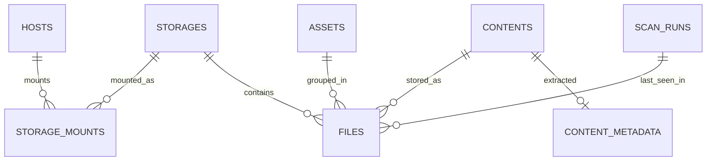

# WING PhotoVault DB スキーマ仕様（Phase 1）

- Version: 0.2.0-draft
- Engine: SQLite 3（WAL モード、`rusqlite` bundled、**各ホストのローカル SSD 上に配置**）
- Migration: `schema_migrations` テーブルによる前方マイグレーション
- 禁止事項: SQLite WAL DB を NAS 上に置き複数ホストから直接開く運用は採用しない

## 1. 接続時 PRAGMA 方針

```sql
PRAGMA journal_mode = WAL;
PRAGMA synchronous = NORMAL;
PRAGMA foreign_keys = ON;
PRAGMA busy_timeout = 5000;
PRAGMA temp_store = MEMORY;
```

- `foreign_keys = ON` により参照整合性を常に強制する。
- `journal_mode = WAL` により読み取り（検索・統計・将来の WING-UI）と書き込み（スキャン）の競合を抑える。
- 耐障害性を損なう `synchronous = OFF` は採用しない。

## 2. ER 概要（Phase 1 / Migration v2 目標構造）



## 3. テーブル定義

> **実装状況の注記**:
> - **Migration v1**（実装済み）: `schema_migrations`, `storages`, `assets`, `contents`, `content_metadata`, `scan_runs`, `files` の基本構造。
> - **Migration v2**（実装済み）: `hosts`, `storage_mounts`, `storages` の権限/状態/障害ドメイン、`assets.public_id`、`files` の `last_seen_at` / `last_verified_at` および `presence` の純化（`offline` をストレージ側へ分離）。

### 3.1 `schema_migrations`
適用済みマイグレーションのバージョン履歴を管理する。

```sql
CREATE TABLE IF NOT EXISTS schema_migrations (
    version     INTEGER PRIMARY KEY,
    name        TEXT NOT NULL,
    applied_at  TEXT NOT NULL
);
```

### 3.2 `hosts` *(Migration v2)*
カタログを操作・スキャンする計算機（Windows PC、macOS、FreeBSD NAS 等）の識別台帳。ホスト名変更に依存しない永続 `id`（UUID 等）を持つ。

```sql
CREATE TABLE IF NOT EXISTS hosts (
    id              TEXT PRIMARY KEY,   -- 永続 Host ID (UUID 等)
    name            TEXT NOT NULL,      -- 表示名 (例: 'main-pc', 'eagle')
    os              TEXT NOT NULL,      -- 'windows' | 'macos' | 'freebsd' | 'linux'
    created_at      TEXT NOT NULL,
    updated_at      TEXT NOT NULL
);
```

### 3.3 `storages`
管理対象ドライブ・NAS 共有の台帳。役割（`tier`）、アクセス権限（`access_mode`）、バックアップ種別（`backup_mode`）、接続・健全状態（`status`）、障害ドメイン（`failure_domain`）を別軸で管理する。

```sql
CREATE TABLE IF NOT EXISTS storages (
    id              TEXT PRIMARY KEY,   -- 固定 Storage ID (例: 'ssd_hot_g', 'nas_backup_eagle')
    root_path       TEXT NOT NULL,      -- ローカル既定パス（v2以降は storage_mounts を正とする）
    media_type      TEXT NOT NULL,      -- 'nvme' | 'ssd' | 'hdd' | 'nas' | 'removable'
    tier            TEXT NOT NULL,      -- 'inbox' | 'hot' | 'archive' | 'backup' | 'quarantine'
    access_mode     TEXT NOT NULL DEFAULT 'managed',   -- (v2) 'managed' | 'read_only'
    backup_mode     TEXT NOT NULL DEFAULT 'none',      -- (v2) 'none' | 'managed' | 'external'
    status          TEXT NOT NULL DEFAULT 'online',    -- (v2) 'online' | 'offline' | 'failed' | 'retired'
    failure_domain  TEXT,               -- (v2) 同一物理ディスク/同一筐体の識別子 (例: 'pc-disk-g', 'nas-eagle')
    volume_id       TEXT,               -- OSボリュームシリアル / 共有識別子
    last_seen_at    TEXT,
    created_at      TEXT NOT NULL,
    updated_at      TEXT NOT NULL
);
```

### 3.4 `storage_mounts` *(Migration v2)*
同一ストレージを複数ホストから異なるパス（Windows のドライブ文字 / UNC パス、macOS の `/Volumes/...`、FreeBSD の `/mnt/...` 等）で参照するためのマッピング。

```sql
CREATE TABLE IF NOT EXISTS storage_mounts (
    storage_id      TEXT NOT NULL REFERENCES storages(id) ON DELETE CASCADE,
    host_id         TEXT NOT NULL REFERENCES hosts(id) ON DELETE CASCADE,
    root_path       TEXT NOT NULL,
    created_at      TEXT NOT NULL,
    updated_at      TEXT NOT NULL,
    PRIMARY KEY (storage_id, host_id)
);
```

### 3.5 `assets`
人間にとっての「1枚の写真（論理資産）」。ローカル内部主キー `id` と、マルチホスト交換・復元用の永続識別子 `public_id`（UUIDv7 等）を分離する。

```sql
CREATE TABLE IF NOT EXISTS assets (
    id                  INTEGER PRIMARY KEY AUTOINCREMENT,
    public_id           TEXT UNIQUE,    -- (v2) 外部交換用永続ID (UUID 等)
    captured_at         TEXT,           -- ISO-8601 (例: '2026-11-24T10:15:30')
    captured_subsec     TEXT,           -- サブ秒文字列 (例: '42')
    camera_make         TEXT,
    camera_model        TEXT,
    camera_serial       TEXT,
    lens_model_raw      TEXT,
    lens_model          TEXT,           -- 正規化後のレンズ名
    focal_length_mm     REAL,
    focal_length_35mm   REAL,
    f_number            REAL,
    shutter_speed_s     REAL,
    shutter_speed_str   TEXT,           -- 表示用 (例: '1/2000')
    iso                 INTEGER,
    exposure_bias       REAL,
    width               INTEGER,
    height              INTEGER,
    orientation         INTEGER,
    gps_lat             REAL,
    gps_lon             REAL,
    duration_ms         INTEGER,        -- 動画用
    fps                 REAL,           -- 動画用
    rating              INTEGER NOT NULL DEFAULT 0,
    pick_status         TEXT NOT NULL DEFAULT 'unreviewed', -- 'unreviewed' | 'pick' | 'reject'
    is_favorite         INTEGER NOT NULL DEFAULT 0,
    hot_pinned          INTEGER NOT NULL DEFAULT 0,
    created_at          TEXT NOT NULL,
    updated_at          TEXT NOT NULL
);
```

### 3.6 `contents`
ファイルの内容（ハッシュ単位）。`(hash_algo, hash_hex)` がグローバルな内容識別子となり、異なるフォルダ構造・ホスト間でのバックアップ済み判定や重複検出の基準となる。

```sql
CREATE TABLE IF NOT EXISTS contents (
    id              INTEGER PRIMARY KEY AUTOINCREMENT,
    hash_algo       TEXT NOT NULL,      -- 'blake3' | 'sha256'
    hash_hex        TEXT NOT NULL,
    byte_size       INTEGER NOT NULL,
    partial_hash    TEXT,               -- 段階的重複検出用（任意）
    media_kind      TEXT NOT NULL,      -- 'image' | 'raw' | 'video' | 'other'
    format          TEXT NOT NULL,      -- 'jpeg' | 'cr3' | 'cr2' | 'crw' | 'heif' | 'mp4' | ...
    created_at      TEXT NOT NULL,
    UNIQUE(hash_algo, hash_hex)
);
```

### 3.7 `content_metadata`
コンテンツ単位で抽出した EXIF / 動画メタデータの取得元・生情報を保持する。

```sql
CREATE TABLE IF NOT EXISTS content_metadata (
    content_id        INTEGER PRIMARY KEY REFERENCES contents(id) ON DELETE CASCADE,
    extractor         TEXT NOT NULL,    -- 'native' | 'native-cr3' | 'exiftool' | 'none'
    captured_at       TEXT,
    captured_subsec   TEXT,
    camera_make       TEXT,
    camera_model      TEXT,
    camera_serial     TEXT,
    lens_model_raw    TEXT,
    lens_model        TEXT,
    focal_length_mm   REAL,
    focal_length_35mm REAL,
    f_number          REAL,
    shutter_speed_s   REAL,
    shutter_speed_str TEXT,
    iso               INTEGER,
    exposure_bias     REAL,
    width             INTEGER,
    height            INTEGER,
    orientation       INTEGER,
    gps_lat           REAL,
    gps_lon           REAL,
    duration_ms       INTEGER,
    fps               REAL,
    raw_json          TEXT,
    extracted_at      TEXT NOT NULL
);
```

### 3.8 `scan_runs`
スキャン実行の履歴と統計。

```sql
CREATE TABLE IF NOT EXISTS scan_runs (
    id                  INTEGER PRIMARY KEY AUTOINCREMENT,
    storage_id          TEXT REFERENCES storages(id),
    started_at          TEXT NOT NULL,
    finished_at         TEXT,
    mode                TEXT NOT NULL,  -- 'incremental' | 'full' | 'verify'
    status              TEXT NOT NULL,  -- 'running' | 'completed' | 'failed'
    files_scanned       INTEGER NOT NULL DEFAULT 0,
    files_added         INTEGER NOT NULL DEFAULT 0,
    files_updated       INTEGER NOT NULL DEFAULT 0,
    files_skipped       INTEGER NOT NULL DEFAULT 0,
    files_missing       INTEGER NOT NULL DEFAULT 0,
    bytes_hashed        INTEGER NOT NULL DEFAULT 0,
    error_count         INTEGER NOT NULL DEFAULT 0,
    message             TEXT
);
```

### 3.9 `files`
各ストレージ上に存在する物理ファイル1個1個のレコード。
- ストレージの未接続（`storages.status = 'offline'`）とファイルの存在状態（`files.presence`）を別軸で管理する。
- 存在確認日時（`last_seen_at`）と内容検証日時（`last_verified_at`）を分離する。

```sql
CREATE TABLE IF NOT EXISTS files (
    id                  INTEGER PRIMARY KEY AUTOINCREMENT,
    storage_id          TEXT NOT NULL REFERENCES storages(id),
    rel_path            TEXT NOT NULL,  -- スラッシュ正規化した相対パス (例: '2026/2026_11_24/100EOSR5/IMG_0001.CR3')
    file_name           TEXT NOT NULL,
    file_stem           TEXT NOT NULL,
    ext                 TEXT NOT NULL,  -- 小文字 (例: '.cr3')
    byte_size           INTEGER NOT NULL,
    mtime_ns            INTEGER NOT NULL,
    ctime_ns            INTEGER,
    content_id          INTEGER REFERENCES contents(id),
    asset_id            INTEGER REFERENCES assets(id),
    role                TEXT NOT NULL DEFAULT 'original', -- 'original' | 'backup' | 'quarantined' | 'exported' | 'sidecar'
    presence            TEXT NOT NULL DEFAULT 'present',  -- 'present' | 'missing' | 'corrupted'
    last_seen_scan_id   INTEGER REFERENCES scan_runs(id),
    last_seen_at        TEXT,           -- (v2) 最後にファイル存在を確認した日時
    last_verified_at    TEXT,           -- (v2) 最後にハッシュ整合性を検証した日時
    created_at          TEXT NOT NULL,
    updated_at          TEXT NOT NULL,
    UNIQUE(storage_id, rel_path)
);
```

## 4. インデックス定義

```sql
CREATE INDEX IF NOT EXISTS idx_files_storage_presence ON files(storage_id, presence);
CREATE INDEX IF NOT EXISTS idx_files_content_id ON files(content_id);
CREATE INDEX IF NOT EXISTS idx_files_asset_id ON files(asset_id);
CREATE INDEX IF NOT EXISTS idx_files_stem_ext ON files(file_stem, ext);
CREATE INDEX IF NOT EXISTS idx_contents_size ON contents(byte_size);
CREATE INDEX IF NOT EXISTS idx_contents_format ON contents(format);
CREATE INDEX IF NOT EXISTS idx_assets_captured_at ON assets(captured_at);
CREATE INDEX IF NOT EXISTS idx_assets_camera_lens ON assets(camera_model, lens_model);
CREATE INDEX IF NOT EXISTS idx_assets_rating_pick ON assets(rating, pick_status);
-- (v2) キーセットページング・検証タスク用
CREATE INDEX IF NOT EXISTS idx_assets_captured_id ON assets(captured_at DESC, id ASC);
CREATE INDEX IF NOT EXISTS idx_files_last_verified ON files(storage_id, last_verified_at);
```

## 5. Phase 2 以降で追加予定のテーブル
- `operation_journal`（Phase 2: 移動・コピー・隔離の状態遷移ジャーナル）
- `file_move_history`（Phase 2: 物理パス移動履歴 — Lightroom 等の外部アプリ参照復旧支援）
- `quarantine_records`（Phase 2: 隔離元パス・理由・復元用メタデータ）
- `folder_pins`（Phase 2/4: フォルダ単位の自動移動除外 Pin）
- `thumbnails`（Phase 5: ローカル SSD 上の永続縮小サムネイル管理）
- `burst_groups` / `tags` / `asset_tags`（Phase 3: 連写グループ・タグ管理）
- `gphotos_uploads`（Phase 7: Google フォト送信履歴）
