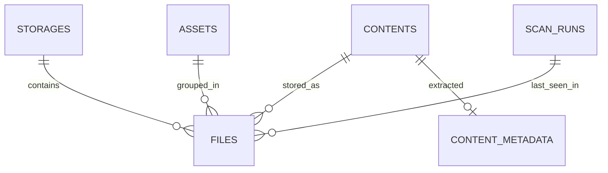

# WING PhotoVault DB スキーマ仕様（Phase 1）

- Version: 0.1.0-draft
- Engine: SQLite 3（WAL モード、`rusqlite` bundled）
- Migration: `schema_migrations` テーブルによる前方マイグレーション

## 1. 接続時 PRAGMA 方針

```sql
PRAGMA journal_mode = WAL;
PRAGMA synchronous = NORMAL;
PRAGMA foreign_keys = ON;
PRAGMA busy_timeout = 5000;
PRAGMA temp_store = MEMORY;
```

- `foreign_keys = ON` により参照整合性を常に強制する。
- `journal_mode = WAL` により読み取り（検索・統計・将来の WING-UI）と書き込み（スキャン）の競合を抑える。
- 耐障害性を損なう `synchronous = OFF` は採用しない。

## 2. ER 概要（Phase 1）



## 3. テーブル定義（Migration v1）

### 3.1 `schema_migrations`
適用済みマイグレーションのバージョン履歴を管理する。

```sql
CREATE TABLE IF NOT EXISTS schema_migrations (
    version     INTEGER PRIMARY KEY,
    name        TEXT NOT NULL,
    applied_at  TEXT NOT NULL
);
```

### 3.2 `storages`
管理対象ドライブ・NAS 共有の台帳。設定ファイルの固定 `id` で識別し、ドライブ文字が変わっても履歴を維持する。

```sql
CREATE TABLE IF NOT EXISTS storages (
    id              TEXT PRIMARY KEY,
    root_path       TEXT NOT NULL,
    media_type      TEXT NOT NULL,      -- 'nvme' | 'ssd' | 'hdd' | 'nas' | 'removable'
    tier            TEXT NOT NULL,      -- 'inbox' | 'hot' | 'archive' | 'backup' | 'quarantine'
    volume_id       TEXT,               -- OSボリュームシリアル / 共有識別子
    last_seen_at    TEXT,
    created_at      TEXT NOT NULL,
    updated_at      TEXT NOT NULL
);
```

### 3.3 `assets`
人間にとっての「1枚の写真（論理資産）」。RAW + JPEG ペアや複数ストレージ上の複製を1つの Asset に束ねる。

```sql
CREATE TABLE IF NOT EXISTS assets (
    id                  INTEGER PRIMARY KEY AUTOINCREMENT,
    captured_at         TEXT,           -- ISO-8601 (例: '2026-11-24T10:15:30')
    captured_subsec     TEXT,           -- サブ秒文字列 (例: '42')
    camera_make         TEXT,
    camera_model        TEXT,
    camera_serial       TEXT,
    lens_model_raw      TEXT,
    lens_model          TEXT,           -- 正規化後のレンズ名
    focal_length_mm     REAL,
    focal_length_35mm   REAL,
    f_number            REAL,
    shutter_speed_s     REAL,
    shutter_speed_str   TEXT,           -- 表示用 (例: '1/2000')
    iso                 INTEGER,
    exposure_bias       REAL,
    width               INTEGER,
    height              INTEGER,
    orientation         INTEGER,
    gps_lat             REAL,
    gps_lon             REAL,
    duration_ms         INTEGER,        -- 動画用
    fps                 REAL,           -- 動画用
    rating              INTEGER NOT NULL DEFAULT 0,
    pick_status         TEXT NOT NULL DEFAULT 'unreviewed', -- 'unreviewed' | 'pick' | 'reject'
    is_favorite         INTEGER NOT NULL DEFAULT 0,
    hot_pinned          INTEGER NOT NULL DEFAULT 0,
    created_at          TEXT NOT NULL,
    updated_at          TEXT NOT NULL
);
```

### 3.4 `contents`
ファイルの内容（ハッシュ単位）。異なるフォルダ構造・ストレージに同じ中身が存在しても1行に統合され、NAS バックアップ済み判定や重複検出の基準となる。

```sql
CREATE TABLE IF NOT EXISTS contents (
    id              INTEGER PRIMARY KEY AUTOINCREMENT,
    hash_algo       TEXT NOT NULL,      -- 'blake3' | 'sha256'
    hash_hex        TEXT NOT NULL,
    byte_size       INTEGER NOT NULL,
    partial_hash    TEXT,               -- 段階的重複検出用（任意）
    media_kind      TEXT NOT NULL,      -- 'image' | 'raw' | 'video' | 'other'
    format          TEXT NOT NULL,      -- 'jpeg' | 'cr3' | 'cr2' | 'crw' | 'heif' | 'mp4' | ...
    created_at      TEXT NOT NULL,
    UNIQUE(hash_algo, hash_hex)
);
```

### 3.5 `content_metadata`
コンテンツ単位で抽出した EXIF / 動画メタデータの取得元・生情報を保持する。ネイティブ解析と ExifTool の比較検証や、将来タグ追加時の再解析抑制に利用する。

```sql
CREATE TABLE IF NOT EXISTS content_metadata (
    content_id      INTEGER PRIMARY KEY REFERENCES contents(id) ON DELETE CASCADE,
    extractor       TEXT NOT NULL,      -- 'native' | 'exiftool' | 'none'
    captured_at     TEXT,
    captured_subsec TEXT,
    camera_make     TEXT,
    camera_model    TEXT,
    camera_serial   TEXT,
    lens_model_raw  TEXT,
    lens_model      TEXT,
    focal_length_mm REAL,
    focal_length_35mm REAL,
    f_number        REAL,
    shutter_speed_s REAL,
    shutter_speed_str TEXT,
    iso             INTEGER,
    exposure_bias   REAL,
    width           INTEGER,
    height          INTEGER,
    orientation     INTEGER,
    gps_lat         REAL,
    gps_lon         REAL,
    duration_ms     INTEGER,
    fps             REAL,
    raw_json        TEXT,               -- 抽出元メタデータJSON（任意）
    extracted_at    TEXT NOT NULL
);
```

### 3.6 `scan_runs`
スキャン実行の履歴と統計。

```sql
CREATE TABLE IF NOT EXISTS scan_runs (
    id                  INTEGER PRIMARY KEY AUTOINCREMENT,
    storage_id          TEXT REFERENCES storages(id),
    started_at          TEXT NOT NULL,
    finished_at         TEXT,
    mode                TEXT NOT NULL,  -- 'incremental' | 'full' | 'verify'
    status              TEXT NOT NULL,  -- 'running' | 'completed' | 'failed'
    files_scanned       INTEGER NOT NULL DEFAULT 0,
    files_added         INTEGER NOT NULL DEFAULT 0,
    files_updated       INTEGER NOT NULL DEFAULT 0,
    files_skipped       INTEGER NOT NULL DEFAULT 0,
    files_missing       INTEGER NOT NULL DEFAULT 0,
    bytes_hashed        INTEGER NOT NULL DEFAULT 0,
    error_count         INTEGER NOT NULL DEFAULT 0,
    message             TEXT
);
```

### 3.7 `files`
各ストレージ上に存在する物理ファイル1個1個のレコード。

```sql
CREATE TABLE IF NOT EXISTS files (
    id                  INTEGER PRIMARY KEY AUTOINCREMENT,
    storage_id          TEXT NOT NULL REFERENCES storages(id),
    rel_path            TEXT NOT NULL,  -- スラッシュ正規化した相対パス (例: '2026/2026_11_24/100EOSR5/IMG_0001.CR3')
    file_name           TEXT NOT NULL,
    file_stem           TEXT NOT NULL,
    ext                 TEXT NOT NULL,  -- 小文字 (例: '.cr3')
    byte_size           INTEGER NOT NULL,
    mtime_ns            INTEGER NOT NULL,
    ctime_ns            INTEGER,
    content_id          INTEGER REFERENCES contents(id),
    asset_id            INTEGER REFERENCES assets(id),
    role                TEXT NOT NULL DEFAULT 'original', -- 'original' | 'backup' | 'quarantined' | 'exported'
    presence            TEXT NOT NULL DEFAULT 'present',  -- 'present' | 'missing' | 'offline'
    last_seen_scan_id   INTEGER REFERENCES scan_runs(id),
    created_at          TEXT NOT NULL,
    updated_at          TEXT NOT NULL,
    UNIQUE(storage_id, rel_path)
);
```

## 4. インデックス定義（Phase 1）

```sql
CREATE INDEX IF NOT EXISTS idx_files_storage_presence ON files(storage_id, presence);
CREATE INDEX IF NOT EXISTS idx_files_content_id ON files(content_id);
CREATE INDEX IF NOT EXISTS idx_files_asset_id ON files(asset_id);
CREATE INDEX IF NOT EXISTS idx_files_stem_ext ON files(file_stem, ext);
CREATE INDEX IF NOT EXISTS idx_contents_size ON contents(byte_size);
CREATE INDEX IF NOT EXISTS idx_contents_format ON contents(format);
CREATE INDEX IF NOT EXISTS idx_assets_captured_at ON assets(captured_at);
CREATE INDEX IF NOT EXISTS idx_assets_camera_lens ON assets(camera_model, lens_model);
CREATE INDEX IF NOT EXISTS idx_assets_rating_pick ON assets(rating, pick_status);
```

## 5. Phase 2 以降で追加予定のテーブル
- `operation_journal`（Phase 2: 移動・コピー・隔離の状態遷移ジャーナル）
- `quarantine_records`（Phase 2: 隔離元パス・理由・復元用メタデータ）
- `burst_groups`（Phase 3: 連写グループ管理）
- `tags` / `asset_tags`（Phase 3: タグ管理）
- `gphotos_uploads`（Phase 7: Googleフォト送信履歴）
